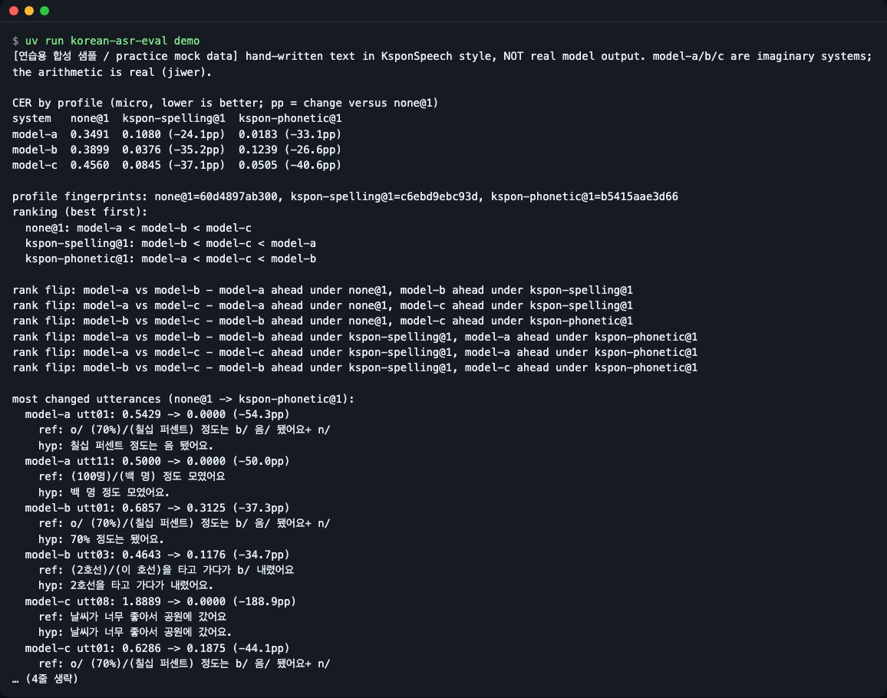
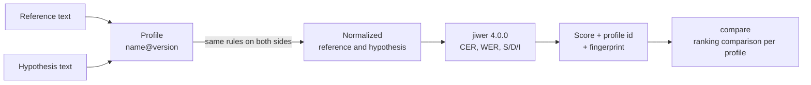
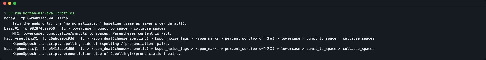
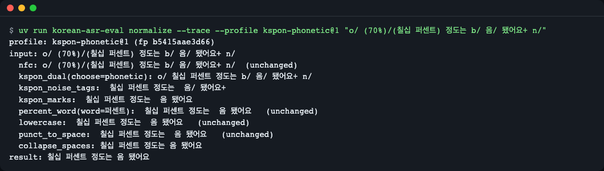
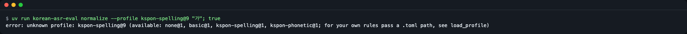
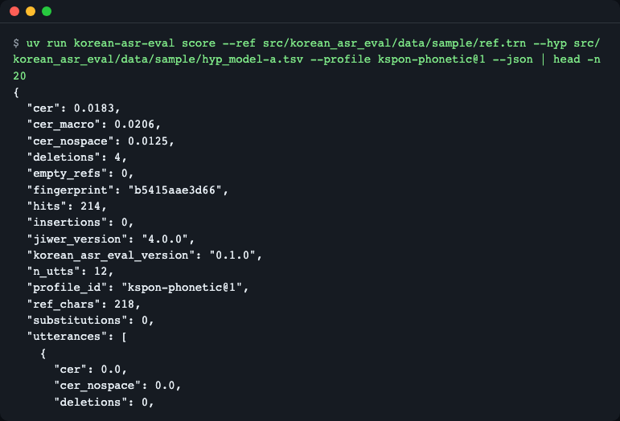
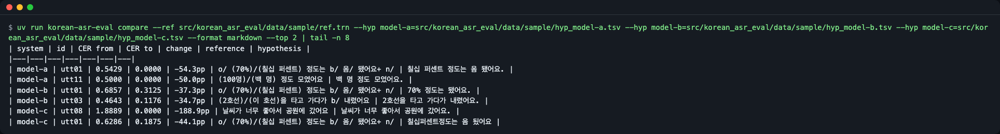
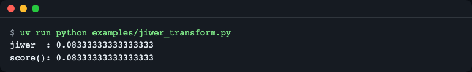

# korean-asr-eval

[한국어](README.md) | **English**

A small Python library and CLI that, when scoring Korean speech recognition (STT), pins the text-normalization rules behind error rates (CER/WER) as named, versioned, fingerprinted *profiles* such as `kspon-phonetic@1`, and shows how much a profile changes scores and model rankings. Distances and substitution/deletion/insertion counts come from [jiwer](https://github.com/jitsi/jiwer) 4.0.0; this package does not reimplement CER. Install: `pip install git+https://github.com/LeeGyeongPil/korean-asr-eval`, then run `korean-asr-eval demo` (offline, bundled hand-written practice data). Python 3.11+, one runtime dependency (`jiwer`).



*Figure 1. Output of `korean-asr-eval demo`. Same systems, same sentences, yet the winner changes just by switching the scoring rules (the profile). The input is hand-written synthetic practice data (see "Synthetic practice data" below).*

## What it saves you from

- **Hand-preprocessing** raw KsponSpeech transcripts (markers such as `(spelling)/(pronunciation)` and `b/ n/ o/`)
- Mistakes where the rules are applied differently to reference and hypothesis (Unicode decomposed form NFD, `%`, and so on)
- **Running scripts again and again** to check "does changing the normalization change the ranking?"
- Wedging Korean normalization into code that already evaluates with `jiwer`

This library is not a new CER calculator. jiwer does the computing; this library handles the **front end (the scoring standard)** and the **back end (reporting how scores and rankings change under that standard)**.

## Installation

```bash
pip install git+https://github.com/LeeGyeongPil/korean-asr-eval
```

- Python 3.11 or later. The only runtime dependency is `jiwer==4.0.0` (jiwer brings rapidfuzz and click with it).
- To run it inside the repo without installing, you need [uv](https://github.com/astral-sh/uv) (see the uv docs for installation). After cloning the repo, run `uv run korean-asr-eval demo`.
- No keys, GPU or network required. After installation it works fully offline.
- Publishing to the package registry (PyPI) happens after the project goes public. Until then, use the GitHub install above.

## 30-second start

```bash
korean-asr-eval demo
```

```text
[연습용 합성 샘플 / practice mock data] hand-written text in KsponSpeech style, NOT real model output. model-a/b/c are imaginary systems; the arithmetic is real (jiwer).

CER by profile (micro, lower is better; pp = change versus none@1)
system   none@1  kspon-spelling@1  kspon-phonetic@1
model-a  0.3491  0.1080 (-24.1pp)  0.0183 (-33.1pp)
model-b  0.3899  0.0376 (-35.2pp)  0.1239 (-26.6pp)
model-c  0.4560  0.0845 (-37.1pp)  0.0505 (-40.6pp)

profile fingerprints: none@1=60d4897ab300, kspon-spelling@1=c6ebd9ebc93d, kspon-phonetic@1=b5415aae3d66
ranking (best first):
  none@1: model-a < model-b < model-c
  kspon-spelling@1: model-b < model-c < model-a
  kspon-phonetic@1: model-a < model-c < model-b
```

(The above is only the first part of the real output (no lines omitted). It continues with the pairs whose ranking flipped and the utterances whose CER changed the most because of normalization. The first line's Korean prefix means "practice synthetic sample".)

How to read it: lower CER is better. `none@1` is the "no normalization" baseline. The same three systems have model-b in first place under `kspon-spelling@1` and model-a under `kspon-phonetic@1`. **The models did not change; the scoring rules did.**

### Synthetic practice data

The reference and hypothesis files used by `demo` are **short sentences written by hand for this project**. They are neither raw KsponSpeech nor output from a real speech-recognition model. `model-a/b/c` are imaginary systems, and the numbers in the table are **not real model performance**. The process that computes the numbers (jiwer), however, is real. In real use, feed in your own model's output files (see "Input formats" below).

## Quick start

Normalize one raw KsponSpeech line.

```python
from korean_asr_eval import normalize, score

ref = "o/ (70%)/(칠십 퍼센트) 정도는 b/ 음/ 됐어요+ n/"
hyp = "칠십 퍼센트 정도는 음 됐어요."

print(normalize(ref, "kspon-phonetic@1"))

r = score([ref], [hyp], "kspon-phonetic@1")
print(r.profile_id, r.fingerprint, "CER", r.cer, "CER-nospace", r.cer_nospace, "WER", r.wer)

r = score([ref], [hyp], "none@1")
print(r.profile_id, r.fingerprint, "CER", r.cer, "S/D/I", r.substitutions, r.deletions, r.insertions)
```

```text
칠십 퍼센트 정도는 음 됐어요
kspon-phonetic@1 b5415aae3d66 CER 0.0 CER-nospace 0.0 WER 0.0
none@1 60d4897ab300 CER 0.5428571428571428 S/D/I 1 18 0
```

For the same hypothesis, using the raw transcript as the reference gives a CER of 0.5429, and after normalization it is 0.0. This file is [`examples/score_one.py`](examples/score_one.py).

Comparing several systems at once with `compare` also takes just 3-4 lines of Python.

```python
from korean_asr_eval import compare

refs = {"u1": "o/ (70%)/(칠십 퍼센트) 정도는 b/ 음/ 됐어요+ n/"}
systems = {"says-words": {"u1": "칠십 퍼센트 정도는 음 됐어요."}, "writes-digits": {"u1": "70퍼센트 정도는 음 됐어요."}}
print(compare(refs, systems, ["none@1", "kspon-phonetic@1"]).to_text())
```

```text
CER by profile (micro, lower is better; pp = change versus none@1)
system         none@1  kspon-phonetic@1
says-words     0.5429  0.0000 (-54.3pp)
writes-digits  0.5714  0.1875 (-38.4pp)

profile fingerprints: none@1=60d4897ab300, kspon-phonetic@1=b5415aae3d66
ranking (best first):
  none@1: says-words < writes-digits
  kspon-phonetic@1: says-words < writes-digits

no rank flips: the ranking is the same under every profile
```

(A "most changed utterances" section follows the output. The full version is in [`examples/quickstart.py`](examples/quickstart.py).)

## Core concepts

**The grading-rubric analogy.** When grading a dictation test you must first decide "may spacing be wrong? Is a number correct whether written `70` or `칠십` (seventy)?" If this standard differs from grader to grader, the same answer sheet gets different scores. A profile is that **grading rubric given a name and a number**.



*Figure 2. The same profile is applied to both reference and hypothesis, and then jiwer computes. The result carries the profile id and fingerprint along.*

- **Profile (`name@version`)**: a name attached to an ordered list of normalization steps. When the meaning changes, the version is raised (existing versions are never deleted).
- **Fingerprint**: the first 12 characters of the sha256 hash of the step list and parameters turned into canonical JSON. If the rules are silently changed, the fingerprint changes. When you write a number into a paper or model card, write `id + fingerprint` together.
- **CER (character error rate)**: edit distance ÷ number of reference characters. The sum of substitutions (S), deletions (D) and insertions (I) is divided by the number of reference characters.
- **micro / macro**: micro is computed over all characters pooled together; macro is the mean of per-utterance CER.

### Why normalization changes the score (all values actually run on the practice data above)

| Scenario | Value |
|---|---|
| A perfect dictation compared directly with the Kspon raw transcript (`none@1`) | CER 0.5429 → 0.0 under `kspon-phonetic@1` |
| A hypothesis that writes the number as `70퍼센트` | 0.0 under `kspon-spelling@1`, 0.1875 under `kspon-phonetic@1` |
| A hypothesis that writes the number as `칠십 퍼센트` | 0.2 under `kspon-spelling@1`, 0.0 under `kspon-phonetic@1` |
| model-c: when there are many spacing errors, `kspon-phonetic@1` | CER 0.0505; ignoring spaces (CER-nospace) 0.0063 |
| One line of model-c is NFD (decomposed Hangul) input | That utterance's CER is 1.8889 under `none@1`, 0 under the other profiles |

The first three rows of the table compare two hypotheses on one line (`o/ (70%)/(칠십 퍼센트) 정도는 b/ 음/ 됐어요+ n/`) and can be reproduced with [`examples/quickstart.py`](examples/quickstart.py). The last two rows are model-c from the `demo` data.

## Profiles

There are four built in (output of `korean-asr-eval profiles`).



*Figure 3. The id, fingerprint and steps of the four built-in profiles. Steps are applied from left to right.*

| id | Fingerprint | What it does |
|---|---|---|
| `none@1` | `60d4897ab300` | Only trims leading and trailing whitespace. The "no normalization" baseline (same as jiwer's default CER transform) |
| `basic@1` | `982874b99050` | NFC → lowercase → punctuation and symbols to spaces → collapse spaces. Text inside parentheses is not removed |
| `kspon-spelling@1` | `c6ebd9ebc93d` | In Kspon transcripts, picks the **spelling** of `(spelling)/(pronunciation)` → removes noise tags (`b/ n/ o/ l/ u/`) → removes marks (`/ + *`) → `%` to `퍼센트` (percent) → the basic steps |
| `kspon-phonetic@1` | `b5415aae3d66` | Same as above, but picks the **pronunciation** |

`kspon-spelling@1` turns `%` into `퍼센트`. So the spelling-side reference `70%` becomes `70퍼센트`, and the CER of the `칠십 퍼센트` hypothesis is 0.2 (this value changes depending on how `%` is handled). Because numbers change depending on which rules were used, state the rules by profile id.

You can see how the text changes at each step with `--trace`.

```bash
korean-asr-eval normalize --trace --profile kspon-phonetic@1 "o/ (70%)/(칠십 퍼센트) 정도는 b/ 음/ 됐어요+ n/"
```

```text
profile: kspon-phonetic@1 (fp b5415aae3d66)
input: o/ (70%)/(칠십 퍼센트) 정도는 b/ 음/ 됐어요+ n/
  nfc: o/ (70%)/(칠십 퍼센트) 정도는 b/ 음/ 됐어요+ n/  (unchanged)
  kspon_dual(choose=phonetic): o/ 칠십 퍼센트 정도는 b/ 음/ 됐어요+ n/
  kspon_noise_tags:  칠십 퍼센트 정도는  음/ 됐어요+ 
  kspon_marks:  칠십 퍼센트 정도는  음 됐어요 
  percent_word(word=퍼센트):  칠십 퍼센트 정도는  음 됐어요   (unchanged)
  lowercase:  칠십 퍼센트 정도는  음 됐어요   (unchanged)
  punct_to_space:  칠십 퍼센트 정도는  음 됐어요   (unchanged)
  collapse_spaces: 칠십 퍼센트 정도는 음 됐어요
result: 칠십 퍼센트 정도는 음 됐어요
```



*Figure 4. One line is cleaned up in the order: dual-transcript choice → tag removal → mark removal → space cleanup.*

An unknown profile id is rejected (exit code 2).

```bash
korean-asr-eval normalize --profile kspon-spelling@9 "가"
```

```text
error: unknown profile: kspon-spelling@9 (available: none@1, basic@1, kspon-spelling@1, kspon-phonetic@1; for your own rules pass a .toml path, see load_profile)
```



*Figure 5. Using a version that does not exist does not pass silently; it raises an error along with the list of available ids.*

## API

Import with `from korean_asr_eval import …`.

| Name | What it does | Main arguments | Returns |
|---|---|---|---|
| `normalize(text, profile)` | Applies a profile to text | `profile` defaults to `"basic@1"`; an id string or a `Profile` | `str` |
| `normalize_trace(text, profile)` | Before/after text for each step | Same as above | `list[TraceStep]` (`step`, `before`, `after`) |
| `get_profile(id)` / `list_profiles()` / `load_profile(path)` | Look up a profile, list profiles, read from TOML | `"name@version"`, a file path | `Profile` / `list[Profile]` |
| `Profile` | Profile value object | `name`, `version`, `steps`, `id`, `fingerprint`, `describe()` | |
| `score(refs, hyps, profile)` | Applies the same profile to both sides and scores | `refs`, `hyps`: `list[str]` or `dict[id, str]`, `ids=` | `Score` |
| `Score` | Bundle of scores | `cer`, `cer_nospace`, `cer_macro`, `wer`, `substitutions`, `deletions`, `insertions`, `hits`, `ref_chars`, `n_utts`, `empty_refs`, `profile_id`, `fingerprint`, `utterances`, `to_dict()` | |
| `compare(refs, systems, profiles, top_n=5)` | System × profile comparison | `systems`: `dict[name, hypotheses]`, `profiles` defaults to 3 | `Comparison` (`table`, `ranks`, `deltas_pp`, `rank_flips`, `top_changed`, `to_dict()`, `to_markdown()`, `to_text()`) |
| `to_jiwer_transform(profile, unit="char", ignore_space=False)` | A transform to plug into jiwer | `unit`: `"char"` or `"word"` | `jiwer.Compose` |
| `read_pairs(path, fmt="auto", encoding="utf-8")` | Reads a file | `fmt`: `tsv`, `jsonl`, `trn`, `txt` | `dict[id, text]` |

Exceptions: `KoreanAsrEvalError` (base), `UnknownProfileError`, `ProfileFormatError` (TOML error), `IdMismatchError` (reference and hypothesis ids do not match), `InputFormatError`. Warning: `EmptyReferenceWarning` (when there are utterances whose reference is empty after normalization).

The command line has five commands: `profiles`, `normalize`, `score`, `compare` and `demo`. Bad input gives exit code 2 and a one-line error message.

## Usage examples

### 1. Scoring your own model's output file

```bash
korean-asr-eval score --ref eval.trn --hyp whisper.tsv --profile kspon-phonetic@1
```

After cloning the repo, running the same command from the repo root with the bundled practice files gives this output.

```bash
korean-asr-eval score --ref src/korean_asr_eval/data/sample/ref.trn --hyp src/korean_asr_eval/data/sample/hyp_model-a.tsv --profile kspon-phonetic@1
```

```text
profile: kspon-phonetic@1 (fp b5415aae3d66)
utterances: 12  reference chars: 218  empty refs: 0
CER         0.0183   (micro, spaces count as characters)
CER-nospace 0.0125   (spaces ignored)
CER-macro   0.0206   (mean of per-utterance CER)
WER         0.0286   (space-separated words)
S/D/I/H     0/4/0/214   (characters)
```

Adding `--json` gives reproducible JSON. Keys are sorted and there are no timestamps or absolute paths, so the same input gives the same bytes.



*Figure 6. The result JSON contains `profile_id`, `fingerprint`, `korean_asr_eval_version` and `jiwer_version`, so someone else can reproduce the same numbers.*

### 2. Checking whether normalization changes the ranking (`compare`)

```bash
korean-asr-eval compare --ref ref.trn --hyp model-a=hyp_a.tsv --hyp model-b=hyp_b.tsv --profile none@1 --profile kspon-phonetic@1
```

The table below was produced from the repo root with the bundled practice files.

```bash
D=src/korean_asr_eval/data/sample
korean-asr-eval compare --ref $D/ref.trn --hyp model-a=$D/hyp_model-a.tsv --hyp model-b=$D/hyp_model-b.tsv --hyp model-c=$D/hyp_model-c.tsv --top 2 --format markdown
```

The first `--profile` is the baseline (the `pp` change is relative to the baseline). If no profiles are given, it uses `none@1`, `kspon-spelling@1` and `kspon-phonetic@1`. `--format markdown` and `--format json` also work. The last section shows "which utterances' errors normalization erased" (practice data, `--top 2`).

```text
| system | id | CER from | CER to | change | reference | hypothesis |
|---|---|---|---|---|---|---|
| model-a | utt01 | 0.5429 | 0.0000 | -54.3pp | o/ (70%)/(칠십 퍼센트) 정도는 b/ 음/ 됐어요+ n/ | 칠십 퍼센트 정도는 음 됐어요. |
| model-a | utt11 | 0.5000 | 0.0000 | -50.0pp | (100명)/(백 명) 정도 모였어요 | 백 명 정도 모였어요. |
| model-b | utt01 | 0.6857 | 0.3125 | -37.3pp | o/ (70%)/(칠십 퍼센트) 정도는 b/ 음/ 됐어요+ n/ | 70% 정도는 됐어요. |
| model-b | utt03 | 0.4643 | 0.1176 | -34.7pp | (2호선)/(이 호선)을 타고 가다가 b/ 내렸어요 | 2호선을 타고 가다가 내렸어요. |
| model-c | utt08 | 1.8889 | 0.0000 | -188.9pp | 날씨가 너무 좋아서 공원에 갔어요 | 날씨가 너무 좋아서 공원에 갔어요. |
| model-c | utt01 | 0.6286 | 0.1875 | -44.1pp | o/ (70%)/(칠십 퍼센트) 정도는 b/ 음/ 됐어요+ n/ | 칠십퍼센트정도는 음 됬어요 |
```

(The Korean sample sentences mean, for example, "about seventy percent was okay", "about a hundred people gathered", "take line 2 and got off", "the weather was so nice that we went to the park".)



*Figure 7. model-c's utt08 is actually a perfect dictation, but it is written in NFD, so without normalization its CER is 1.8889.*

### 3. Plugging into jiwer code

For code that already evaluated with `jiwer.cer`, you only need to add one transform. The numbers are the same as `score()`.

```python
import jiwer

from korean_asr_eval import score, to_jiwer_transform

refs = ["o/ (70%)/(칠십 퍼센트) 정도는 b/ 음/ 됐어요+ n/", "(3시)/(세 시)에 만나요"]
hyps = ["칠십 퍼센트 정도는 음 됐어요.", "3시에 만나요"]

t = to_jiwer_transform("kspon-phonetic@1")
print("jiwer  :", jiwer.cer(refs, hyps, reference_transform=t, hypothesis_transform=t))
print("score():", score(refs, hyps, "kspon-phonetic@1").cer)
```

```text
jiwer  : 0.08333333333333333
score(): 0.08333333333333333
```

File: [`examples/jiwer_transform.py`](examples/jiwer_transform.py).



*Figure 8. The result of plugging the transform into jiwer and the result of `score()` are the same number.*

### 4. Pinning your team's profile in TOML

`examples/my-lab.toml`:

```toml
name = "my-lab"
version = 2
extends = "basic@1"
description = "Team rules: hanja numerals and a unit symbol spelled out."

[replace]
"三十" = "삼십"
"㎏" = "킬로그램"
```

```python
from pathlib import Path

from korean_asr_eval import load_profile, normalize

profile = load_profile(Path(__file__).with_name("my-lab.toml"))
print(profile.id, profile.fingerprint)

text = "三十 명, 5㎏ 입니다"
print(normalize(text, profile))
print(normalize(text, "basic@1"))
```

```text
my-lab@2 05979c04babb
삼십 명 5킬로그램 입니다
三十 명 5 입니다
```

`extends` inherits an existing profile, and the `[replace]` table adds substitutions. You can also append steps with `[[steps]]`. Changing the rules changes the fingerprint, so the numbers never get mixed with those of other rules. Hanja conversion is not built in, so handle it with a substitution table like this. File: [`examples/team_profile.py`](examples/team_profile.py). On the CLI, pass a path such as `--profile examples/my-lab.toml`.

### Input formats

| Format | Shape of one line |
|---|---|
| `tsv` | `id<TAB>text` |
| `jsonl` | `{"id": ..., "text": ...}` |
| `trn` | `path :: transcript` (the id is the file-name stem, e.g. `sample/utt01.wav` → `utt01`) |
| `txt` | The line number is the id |

The format is chosen by file extension and can be specified with `--ref-format`/`--hyp-format` (or `read_pairs(fmt=)`). For cp949 files such as the original KsponSpeech, pass `--encoding cp949` (use `--ref-encoding cp949` if only the reference is cp949, or `--hyp-encoding cp949` if only the hypothesis is). If the reference and hypothesis ids do not match, it does not pass silently but raises `IdMismatchError` (exit code 2 on the CLI).

### How to read the results

- **CER (micro)**: counts spaces as characters. **CER-nospace**: ignores spaces. If your evaluation tolerates spacing mistakes, look at the latter.
- **WER**: based on space-separated words (eojeol).
- **S/D/I/H**: character-level counts of substitutions, deletions, insertions and hits.
- **Empty references**: if the reference becomes empty after normalization (a line with only tags, etc.), that utterance is counted in `empty_refs` and left out of the macro mean. It is included in micro as insertions, and an `EmptyReferenceWarning` is raised (on the CLI, a `warning:` line on stderr).

## When to use it

- Good fits: comparing Korean STT candidate models by the same standard, scoring KsponSpeech-family transcripts, and wanting to pin an evaluation script's normalization rules by name and fingerprint.
- Scope: a step that reads numbers out in Hangul (`70` → `칠십`) and Hanja conversion do not exist yet. If this matters to you, handle it with a TOML substitution table for now.
- When to use other tools: if the goal is just language-neutral WER/CER computation, use [jiwer](https://github.com/jitsi/jiwer); if you need Korean CER/WER computation and system comparison in one package, [nlptutti](https://pypi.org/project/nlptutti/); to use Whisper's English-centric default normalization as is, [whisper-normalizer](https://pypi.org/project/whisper-normalizer/). (Only names and links are given. Check each one's docs for features.)

## Limitations and plans

- A number/symbol reading step (`ko_numbers`), a comparison profile that imitates Whisper's default normalization, and an alignment diff HTML are planned for later versions.
- The Kspon handling rules are a fresh implementation based on the behavior described in published preprocessing explanations. The parts that may differ from the original (such as `%` handling) are noted in the profile table above.
- The bundled samples are synthetic practice data. They say nothing about real model rankings.
- There is not yet an example that runs a real speech-recognition model. This library scores model output files.

## Versions and compatibility

- Follows Semantic Versioning (SemVer). During 0.x the API may change in minor versions, and any change is recorded in [CHANGELOG.md](CHANGELOG.md).
- When the meaning of a default profile changes, a new version (`@2`) is added and the existing version and its fingerprint do not change (pinned by tests).

## Development and contributing

```bash
uv sync
uv run pytest -q
uv run korean-asr-eval demo
```

The tests run without a network. In this repo's development environment, `uv run pytest -q` passed 65 tests.

## Learn more (links checked 2026-11-10)

- jiwer: <https://github.com/jitsi/jiwer>
- KoSpeech paper (points out the lack of standard preprocessing): <https://arxiv.org/abs/2009.03092>
- Discussion about spaces in HF evaluate `cer`: <https://huggingface.co/spaces/evaluate-metric/cer/discussions/4>

## License

MIT. The bundled samples (`src/korean_asr_eval/data/sample/`) are synthetic text written by hand and are distributed under the same license.
