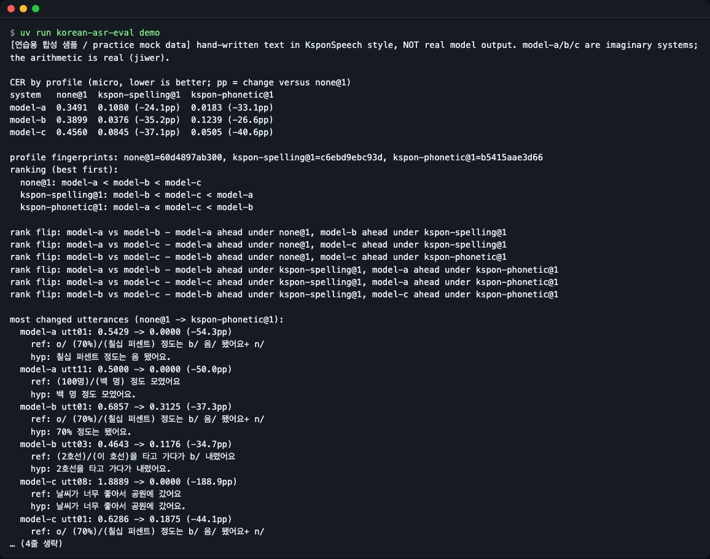
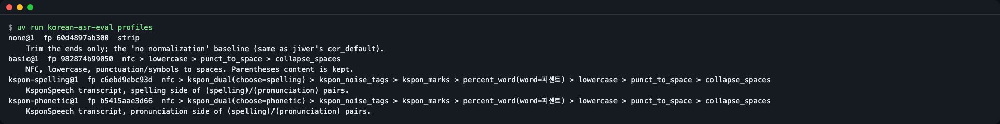
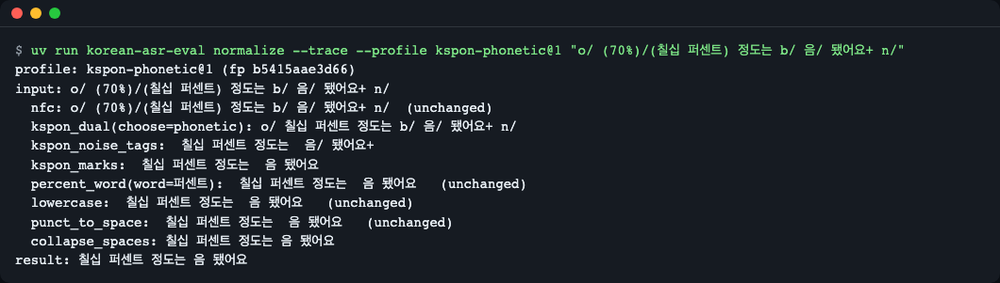
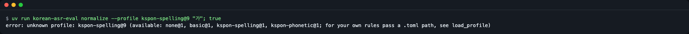
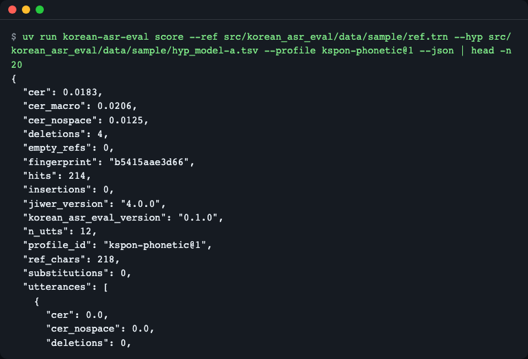
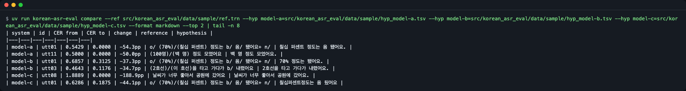
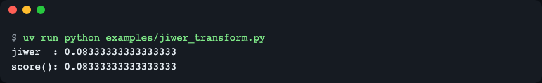

# korean-asr-eval

**한국어** | [English](README.en.md)

> **English summary** — A small Python library and CLI that pins the text-normalization rules behind Korean speech-recognition error rates (CER/WER) as named, versioned, fingerprinted *profiles* such as `kspon-phonetic@1`, and shows how much a profile changes scores and model rankings. Distances and substitution/deletion/insertion counts come from [jiwer](https://github.com/jitsi/jiwer) 4.0.0; this package does not reimplement CER. Install: `pip install git+https://github.com/LeeGyeongPil/korean-asr-eval`, then run `korean-asr-eval demo` (offline, bundled hand-written practice data). Python 3.11+, one runtime dependency (`jiwer`).

한국어 음성인식(STT) 결과를 채점할 때 **정규화 규칙을 `kspon-phonetic@1` 같은 이름·버전으로 고정**하고, 그 규칙이 점수와 모델 순위를 얼마나 바꾸는지 함께 보여 주는 파이썬 라이브러리 + 명령줄 도구입니다.



*그림 1. `korean-asr-eval demo` 실행 결과. 같은 시스템, 같은 문장인데 채점 규칙(프로파일)만 바꿨더니 1등이 바뀝니다. 입력은 직접 쓴 연습용 합성 데이터입니다(아래 "연습용 합성 데이터" 참고).*

## 무엇을 덜 귀찮게 하나

- KsponSpeech 원문 전사(`(철자)/(발음)`, `b/ n/ o/` 같은 표시)를 **손으로 전처리하는 일**
- 참조와 가설에 규칙을 다르게 적용하는 실수(유니코드 분해형 NFD, `%` 등)
- "정규화를 바꾸면 순위가 바뀌나?"를 확인하려고 **스크립트를 여러 번 돌리는 일**
- 이미 `jiwer` 로 평가하는 코드에 한국어 정규화를 끼워 넣는 일

이 라이브러리는 CER 계산기를 새로 만든 것이 아닙니다. 계산은 jiwer 가 하고, 이 라이브러리는 그 **앞단(채점 기준)** 과 **뒷단(기준에 따른 점수·순위 변화 보고)** 을 맡습니다.

## 설치

```bash
pip install git+https://github.com/LeeGyeongPil/korean-asr-eval
```

- Python 3.11 이상. 런타임 의존성은 `jiwer==4.0.0` 하나입니다(jiwer 가 rapidfuzz·click 을 함께 가져옵니다).
- 설치 없이 레포 안에서 돌려 보려면 [uv](https://github.com/astral-sh/uv) 가 필요합니다(설치 방법은 uv 문서 참고). 레포를 받은 뒤 `uv run korean-asr-eval demo` 를 실행합니다.
- 키·GPU·네트워크가 필요 없습니다. 설치 뒤에는 완전히 오프라인으로 동작합니다.
- 패키지 레지스트리(PyPI) 게시는 공개 뒤에 이루어집니다. 그 전에는 위 GitHub 설치를 쓰세요.

## 30초 시작

```bash
korean-asr-eval demo
```

```text
[연습용 합성 샘플 / practice mock data] hand-written text in KsponSpeech style, NOT real model output. model-a/b/c are imaginary systems; the arithmetic is real (jiwer).

CER by profile (micro, lower is better; pp = change versus none@1)
system   none@1  kspon-spelling@1  kspon-phonetic@1
model-a  0.3491  0.1080 (-24.1pp)  0.0183 (-33.1pp)
model-b  0.3899  0.0376 (-35.2pp)  0.1239 (-26.6pp)
model-c  0.4560  0.0845 (-37.1pp)  0.0505 (-40.6pp)

profile fingerprints: none@1=60d4897ab300, kspon-spelling@1=c6ebd9ebc93d, kspon-phonetic@1=b5415aae3d66
ranking (best first):
  none@1: model-a < model-b < model-c
  kspon-spelling@1: model-b < model-c < model-a
  kspon-phonetic@1: model-a < model-c < model-b
```

(위는 실제 실행 출력에서 앞부분만 옮긴 것입니다(줄 생략 없음). 이어서 순위가 뒤집힌 쌍과 정규화 때문에 CER 이 가장 많이 바뀐 발화가 나옵니다.)

읽는 법: CER 은 낮을수록 좋습니다. `none@1` 은 "정규화 안 함" 기준선입니다. 같은 세 시스템이 `kspon-spelling@1` 에서는 model-b 가, `kspon-phonetic@1` 에서는 model-a 가 1등입니다. **모델이 바뀐 것이 아니라 채점 규칙이 바뀐 것**입니다.

### 연습용 합성 데이터

`demo` 에 쓰이는 참조·가설 파일은 이 프로젝트를 위해 **직접 쓴 짧은 문장**입니다. KsponSpeech 원문도, 실제 음성인식 모델의 출력도 아닙니다. `model-a/b/c` 는 가상의 시스템이고, 표의 숫자는 **실제 모델 성능이 아닙니다**. 다만 숫자를 계산하는 과정(jiwer)은 진짜입니다. 실제로 쓸 때는 자기 모델의 출력 파일을 넣으면 됩니다(아래 "입력 형식").

## 빠르게 시작하기

KsponSpeech 원문 한 줄을 정규화합니다.

```python
from korean_asr_eval import normalize, score

ref = "o/ (70%)/(칠십 퍼센트) 정도는 b/ 음/ 됐어요+ n/"
hyp = "칠십 퍼센트 정도는 음 됐어요."

print(normalize(ref, "kspon-phonetic@1"))

r = score([ref], [hyp], "kspon-phonetic@1")
print(r.profile_id, r.fingerprint, "CER", r.cer, "CER-nospace", r.cer_nospace, "WER", r.wer)

r = score([ref], [hyp], "none@1")
print(r.profile_id, r.fingerprint, "CER", r.cer, "S/D/I", r.substitutions, r.deletions, r.insertions)
```

```text
칠십 퍼센트 정도는 음 됐어요
kspon-phonetic@1 b5415aae3d66 CER 0.0 CER-nospace 0.0 WER 0.0
none@1 60d4897ab300 CER 0.5428571428571428 S/D/I 1 18 0
```

같은 가설인데 전사 원문을 그대로 참조로 쓰면 CER 이 0.5429, 정규화한 뒤에는 0.0 입니다. 이 파일은 [`examples/score_one.py`](examples/score_one.py) 입니다.

여러 시스템을 한 번에 비교하는 `compare` 도 파이썬에서 3~4줄입니다.

```python
from korean_asr_eval import compare

refs = {"u1": "o/ (70%)/(칠십 퍼센트) 정도는 b/ 음/ 됐어요+ n/"}
systems = {"says-words": {"u1": "칠십 퍼센트 정도는 음 됐어요."}, "writes-digits": {"u1": "70퍼센트 정도는 음 됐어요."}}
print(compare(refs, systems, ["none@1", "kspon-phonetic@1"]).to_text())
```

```text
CER by profile (micro, lower is better; pp = change versus none@1)
system         none@1  kspon-phonetic@1
says-words     0.5429  0.0000 (-54.3pp)
writes-digits  0.5714  0.1875 (-38.4pp)

profile fingerprints: none@1=60d4897ab300, kspon-phonetic@1=b5415aae3d66
ranking (best first):
  none@1: says-words < writes-digits
  kspon-phonetic@1: says-words < writes-digits

no rank flips: the ranking is the same under every profile
```

(출력 뒤에 "most changed utterances" 절이 더 나옵니다. 전체는 [`examples/quickstart.py`](examples/quickstart.py).)

## 핵심 개념

**채점 기준표 비유.** 받아쓰기 시험을 채점할 때 "띄어쓰기는 틀려도 되나? 숫자는 `70` 이나 `칠십` 이나 다 맞나?"를 먼저 정해야 합니다. 이 기준이 채점자마다 다르면 같은 답안이 다른 점수를 받습니다. 프로파일은 그 **채점 기준표에 이름과 번호를 붙인 것**입니다.

```mermaid
flowchart LR
  REF[참조 텍스트] --> P[프로파일<br/>name@version]
  HYP[가설 텍스트] --> P
  P -->|양쪽에 같은 규칙| N[정규화된<br/>참조·가설]
  N --> J[jiwer 4.0.0<br/>CER·WER·S/D/I]
  J --> S[점수 + 프로파일 id<br/>+ 지문]
  S --> C[compare<br/>프로파일별 순위 비교]
```

*그림 2. 참조와 가설 양쪽에 같은 프로파일을 적용한 뒤 jiwer 가 계산합니다. 결과에는 프로파일 id 와 지문이 따라붙습니다.*

- **프로파일(`name@version`)**: 정규화 단계의 순서 있는 목록에 붙인 이름. 의미가 바뀌면 버전을 올립니다(기존 버전은 지우지 않습니다).
- **지문(fingerprint)**: 단계 목록과 파라미터를 정규 JSON 으로 바꿔 sha256 해시를 낸 앞 12자. 규칙이 몰래 바뀌면 지문이 바뀝니다. 숫자를 논문·모델 카드에 적을 때 `id + 지문` 을 함께 적으세요.
- **CER(문자 오류율)**: 편집 거리 ÷ 참조 글자 수. 교체(S)·삭제(D)·삽입(I)의 합을 참조 글자 수로 나눕니다.
- **micro / macro**: micro 는 전체 글자를 합쳐서 계산한 값, macro 는 발화별 CER 의 평균입니다.

### 왜 정규화가 점수를 바꾸나 (전부 위 연습 데이터로 직접 실행한 값)

| 장면 | 값 |
|---|---|
| 완벽한 받아쓰기를 Kspon 원문과 그대로 비교(`none@1`) | CER 0.5429 → `kspon-phonetic@1` 에서 0.0 |
| 숫자를 `70퍼센트` 로 쓰는 가설 | `kspon-spelling@1` 에서 0.0, `kspon-phonetic@1` 에서 0.1875 |
| 숫자를 `칠십 퍼센트` 로 쓰는 가설 | `kspon-spelling@1` 에서 0.2, `kspon-phonetic@1` 에서 0.0 |
| model-c: 띄어쓰기 오류가 많을 때 `kspon-phonetic@1` | CER 0.0505, 공백을 무시하면(CER-nospace) 0.0063 |
| model-c 의 한 줄이 NFD(분해형 한글) 입력 | `none@1` 에서 그 발화 CER 1.8889, 다른 프로파일에서는 0 |

표의 앞 세 줄은 한 줄(`o/ (70%)/(칠십 퍼센트) 정도는 b/ 음/ 됐어요+ n/`)에 가설 두 개를 비교한 것으로, [`examples/quickstart.py`](examples/quickstart.py) 로 재현됩니다. 뒤 두 줄은 `demo` 데이터의 model-c 입니다.

## 프로파일

기본 4종입니다(`korean-asr-eval profiles` 출력).



*그림 3. 기본 프로파일 4종의 id·지문·단계. 단계는 왼쪽에서 오른쪽 순서로 적용됩니다.*

| id | 지문 | 하는 일 |
|---|---|---|
| `none@1` | `60d4897ab300` | 앞뒤 공백만 정리. "정규화 안 함" 기준선(jiwer 의 기본 CER 변환과 같음) |
| `basic@1` | `982874b99050` | NFC → 소문자 → 문장부호·기호를 공백으로 → 공백 정리. 괄호 안 텍스트는 지우지 않음 |
| `kspon-spelling@1` | `c6ebd9ebc93d` | Kspon 전사에서 `(철자)/(발음)` 중 **철자** 선택 → 잡음 태그(`b/ n/ o/ l/ u/`) 제거 → 표시(`/ + *`) 제거 → `%` 를 `퍼센트` 로 → basic 단계 |
| `kspon-phonetic@1` | `b5415aae3d66` | 위와 같되 **발음** 선택 |

`kspon-spelling@1` 은 `%` 를 `퍼센트` 로 바꿉니다. 그래서 철자 쪽 참조 `70%` 는 `70퍼센트` 가 되고, `칠십 퍼센트` 가설의 CER 은 0.2 입니다(`%` 를 어떻게 다루느냐에 따라 이 값은 달라집니다). 이처럼 어느 규칙을 썼는지에 따라 숫자가 달라지므로, 규칙은 프로파일 id 로 밝혀야 합니다.

단계마다 텍스트가 어떻게 바뀌는지는 `--trace` 로 볼 수 있습니다.

```bash
korean-asr-eval normalize --trace --profile kspon-phonetic@1 "o/ (70%)/(칠십 퍼센트) 정도는 b/ 음/ 됐어요+ n/"
```

```text
profile: kspon-phonetic@1 (fp b5415aae3d66)
input: o/ (70%)/(칠십 퍼센트) 정도는 b/ 음/ 됐어요+ n/
  nfc: o/ (70%)/(칠십 퍼센트) 정도는 b/ 음/ 됐어요+ n/  (unchanged)
  kspon_dual(choose=phonetic): o/ 칠십 퍼센트 정도는 b/ 음/ 됐어요+ n/
  kspon_noise_tags:  칠십 퍼센트 정도는  음/ 됐어요+ 
  kspon_marks:  칠십 퍼센트 정도는  음 됐어요 
  percent_word(word=퍼센트):  칠십 퍼센트 정도는  음 됐어요   (unchanged)
  lowercase:  칠십 퍼센트 정도는  음 됐어요   (unchanged)
  punct_to_space:  칠십 퍼센트 정도는  음 됐어요   (unchanged)
  collapse_spaces: 칠십 퍼센트 정도는 음 됐어요
result: 칠십 퍼센트 정도는 음 됐어요
```



*그림 4. 이중 전사 선택 → 태그 제거 → 표시 제거 → 공백 정리 순서로 한 줄이 정리됩니다.*

모르는 프로파일 id 는 거절합니다(종료코드 2).

```bash
korean-asr-eval normalize --profile kspon-spelling@9 "가"
```

```text
error: unknown profile: kspon-spelling@9 (available: none@1, basic@1, kspon-spelling@1, kspon-phonetic@1; for your own rules pass a .toml path, see load_profile)
```



*그림 5. 존재하지 않는 버전을 쓰면 조용히 넘어가지 않고 사용 가능한 id 목록과 함께 오류를 냅니다.*

## API

`from korean_asr_eval import …` 로 가져옵니다.

| 이름 | 하는 일 | 주요 인자 | 반환 |
|---|---|---|---|
| `normalize(text, profile)` | 텍스트에 프로파일 적용 | `profile` 기본 `"basic@1"`, id 문자열 또는 `Profile` | `str` |
| `normalize_trace(text, profile)` | 단계별 전후 텍스트 | 위와 같음 | `list[TraceStep]` (`step`, `before`, `after`) |
| `get_profile(id)` / `list_profiles()` / `load_profile(path)` | 프로파일 조회·목록·TOML 읽기 | `"name@version"`, 파일 경로 | `Profile` / `list[Profile]` |
| `Profile` | 프로파일 값 객체 | `name`, `version`, `steps`, `id`, `fingerprint`, `describe()` | |
| `score(refs, hyps, profile)` | 같은 프로파일을 양쪽에 적용해 채점 | `refs`·`hyps`: `list[str]` 또는 `dict[id, str]`, `ids=` | `Score` |
| `Score` | 점수 묶음 | `cer`, `cer_nospace`, `cer_macro`, `wer`, `substitutions`, `deletions`, `insertions`, `hits`, `ref_chars`, `n_utts`, `empty_refs`, `profile_id`, `fingerprint`, `utterances`, `to_dict()` | |
| `compare(refs, systems, profiles, top_n=5)` | 시스템 × 프로파일 비교 | `systems`: `dict[name, 가설]`, `profiles` 기본 3종 | `Comparison` (`table`, `ranks`, `deltas_pp`, `rank_flips`, `top_changed`, `to_dict()`, `to_markdown()`, `to_text()`) |
| `to_jiwer_transform(profile, unit="char", ignore_space=False)` | jiwer 에 꽂는 변환 | `unit`: `"char"` 또는 `"word"` | `jiwer.Compose` |
| `read_pairs(path, fmt="auto", encoding="utf-8")` | 파일 읽기 | `fmt`: `tsv`·`jsonl`·`trn`·`txt` | `dict[id, text]` |

예외: `KoreanAsrEvalError`(기반), `UnknownProfileError`, `ProfileFormatError`(TOML 오류), `IdMismatchError`(참조·가설 id 어긋남), `InputFormatError`. 경고: `EmptyReferenceWarning`(정규화 뒤 빈 참조 발화가 있을 때).

명령줄은 `profiles`, `normalize`, `score`, `compare`, `demo` 다섯 개입니다. 잘못된 입력은 종료코드 2 와 한 줄 오류 메시지를 냅니다.

## 사용 예

### 1. 내 모델 출력 파일을 채점하기

```bash
korean-asr-eval score --ref eval.trn --hyp whisper.tsv --profile kspon-phonetic@1
```

레포를 받은 뒤 레포 루트에서 동봉 연습 파일로 같은 명령을 돌리면 이런 출력입니다.

```bash
korean-asr-eval score --ref src/korean_asr_eval/data/sample/ref.trn --hyp src/korean_asr_eval/data/sample/hyp_model-a.tsv --profile kspon-phonetic@1
```

```text
profile: kspon-phonetic@1 (fp b5415aae3d66)
utterances: 12  reference chars: 218  empty refs: 0
CER         0.0183   (micro, spaces count as characters)
CER-nospace 0.0125   (spaces ignored)
CER-macro   0.0206   (mean of per-utterance CER)
WER         0.0286   (space-separated words)
S/D/I/H     0/4/0/214   (characters)
```

`--json` 를 붙이면 재현 가능한 JSON 이 나옵니다. 키는 정렬되어 있고 시각·절대 경로가 없어서 같은 입력이면 같은 바이트입니다.



*그림 6. 결과 JSON 에는 `profile_id`·`fingerprint`·`korean_asr_eval_version`·`jiwer_version` 이 들어 있어 다른 사람이 같은 숫자를 재현할 수 있습니다.*

### 2. 정규화가 순위를 바꾸는지 확인하기 (`compare`)

```bash
korean-asr-eval compare --ref ref.trn --hyp model-a=hyp_a.tsv --hyp model-b=hyp_b.tsv --profile none@1 --profile kspon-phonetic@1
```

아래 표는 레포 루트에서 동봉 연습 파일로 만든 것입니다.

```bash
D=src/korean_asr_eval/data/sample
korean-asr-eval compare --ref $D/ref.trn --hyp model-a=$D/hyp_model-a.tsv --hyp model-b=$D/hyp_model-b.tsv --hyp model-c=$D/hyp_model-c.tsv --top 2 --format markdown
```

첫 번째 `--profile` 이 기준선입니다(`pp` 변화는 기준선 대비). 프로파일을 주지 않으면 `none@1`, `kspon-spelling@1`, `kspon-phonetic@1` 을 씁니다. `--format markdown` 이나 `--format json` 도 됩니다. 마지막 절은 "정규화가 지운 오류가 어떤 발화였는지"입니다(연습 데이터, `--top 2`).

```text
| system | id | CER from | CER to | change | reference | hypothesis |
|---|---|---|---|---|---|---|
| model-a | utt01 | 0.5429 | 0.0000 | -54.3pp | o/ (70%)/(칠십 퍼센트) 정도는 b/ 음/ 됐어요+ n/ | 칠십 퍼센트 정도는 음 됐어요. |
| model-a | utt11 | 0.5000 | 0.0000 | -50.0pp | (100명)/(백 명) 정도 모였어요 | 백 명 정도 모였어요. |
| model-b | utt01 | 0.6857 | 0.3125 | -37.3pp | o/ (70%)/(칠십 퍼센트) 정도는 b/ 음/ 됐어요+ n/ | 70% 정도는 됐어요. |
| model-b | utt03 | 0.4643 | 0.1176 | -34.7pp | (2호선)/(이 호선)을 타고 가다가 b/ 내렸어요 | 2호선을 타고 가다가 내렸어요. |
| model-c | utt08 | 1.8889 | 0.0000 | -188.9pp | 날씨가 너무 좋아서 공원에 갔어요 | 날씨가 너무 좋아서 공원에 갔어요. |
| model-c | utt01 | 0.6286 | 0.1875 | -44.1pp | o/ (70%)/(칠십 퍼센트) 정도는 b/ 음/ 됐어요+ n/ | 칠십퍼센트정도는 음 됬어요 |
```



*그림 7. model-c 의 utt08 은 사실 완벽한 받아쓰기인데 NFD 로 적혀 있어서 정규화 없이는 CER 이 1.8889 입니다.*

### 3. jiwer 코드에 끼워 넣기

이미 `jiwer.cer` 로 평가하던 코드에는 변환 한 줄만 더하면 됩니다. 숫자는 `score()` 와 같습니다.

```python
import jiwer

from korean_asr_eval import score, to_jiwer_transform

refs = ["o/ (70%)/(칠십 퍼센트) 정도는 b/ 음/ 됐어요+ n/", "(3시)/(세 시)에 만나요"]
hyps = ["칠십 퍼센트 정도는 음 됐어요.", "3시에 만나요"]

t = to_jiwer_transform("kspon-phonetic@1")
print("jiwer  :", jiwer.cer(refs, hyps, reference_transform=t, hypothesis_transform=t))
print("score():", score(refs, hyps, "kspon-phonetic@1").cer)
```

```text
jiwer  : 0.08333333333333333
score(): 0.08333333333333333
```

파일: [`examples/jiwer_transform.py`](examples/jiwer_transform.py).



*그림 8. jiwer 에 변환을 꽂은 결과와 `score()` 결과가 같은 숫자입니다.*

### 4. 우리 팀 프로파일을 TOML 로 고정하기

`examples/my-lab.toml`:

```toml
name = "my-lab"
version = 2
extends = "basic@1"
description = "Team rules: hanja numerals and a unit symbol spelled out."

[replace]
"三十" = "삼십"
"㎏" = "킬로그램"
```

```python
from pathlib import Path

from korean_asr_eval import load_profile, normalize

profile = load_profile(Path(__file__).with_name("my-lab.toml"))
print(profile.id, profile.fingerprint)

text = "三十 명, 5㎏ 입니다"
print(normalize(text, profile))
print(normalize(text, "basic@1"))
```

```text
my-lab@2 05979c04babb
삼십 명 5킬로그램 입니다
三十 명 5 입니다
```

`extends` 로 기존 프로파일을 이어받고 `[replace]` 표로 치환을 더합니다. `[[steps]]` 로 단계를 덧붙일 수도 있습니다. 규칙을 바꾸면 지문이 바뀌므로 다른 규칙의 숫자와 섞이지 않습니다. 한자 변환은 내장하지 않으니 이렇게 치환 표로 처리하세요. 파일: [`examples/team_profile.py`](examples/team_profile.py). CLI 에서는 `--profile examples/my-lab.toml` 처럼 경로를 줍니다.

### 입력 형식

| 형식 | 한 줄의 모양 |
|---|---|
| `tsv` | `id<TAB>text` |
| `jsonl` | `{"id": ..., "text": ...}` |
| `trn` | `경로 :: 전사` (id 는 파일 이름 줄기, 예: `sample/utt01.wav` → `utt01`) |
| `txt` | 줄 번호가 id |

파일 확장자로 형식을 고르고, `--ref-format`/`--hyp-format`(또는 `read_pairs(fmt=)`)로 지정할 수 있습니다. 원본 KsponSpeech 처럼 cp949 파일이면 `--encoding cp949` 를 줍니다(참조만 cp949 면 `--ref-encoding cp949`, 가설만이면 `--hyp-encoding cp949`). 참조와 가설의 id 가 어긋나면 조용히 넘어가지 않고 `IdMismatchError`(CLI 는 종료코드 2)를 냅니다.

### 결과 읽는 법

- **CER (micro)**: 공백도 글자로 셉니다. **CER-nospace**: 공백을 무시. 띄어쓰기를 틀려도 되는 평가라면 후자를 보세요.
- **WER**: 공백으로 나눈 어절 기준.
- **S/D/I/H**: 글자 단위 교체·삭제·삽입·일치 수.
- **빈 참조**: 정규화 뒤 참조가 비면(태그만 있는 줄 등) 그 발화는 `empty_refs` 로 세고 macro 평균에서 뺍니다. micro 에는 삽입으로 포함되며 `EmptyReferenceWarning`(CLI 는 stderr 의 `warning:` 줄)이 나옵니다.

## 언제 쓰나

- 이럴 때: 한국어 STT 후보 모델을 같은 기준으로 비교할 때, KsponSpeech 계열 전사를 채점해야 할 때, 평가 스크립트의 정규화 규칙을 이름과 지문으로 고정해 두고 싶을 때.
- 범위: 숫자를 한글로 읽는 단계(`70` → `칠십`)와 한자 변환은 아직 없습니다. 이 점이 중요하면 지금은 TOML 치환 표로 처리하세요.
- 이럴 땐 다른 도구: 언어 중립 WER/CER 계산 자체가 목적이면 [jiwer](https://github.com/jitsi/jiwer), 한국어 CER/WER 계산과 시스템 비교가 한 패키지에 필요하면 [nlptutti](https://pypi.org/project/nlptutti/), Whisper 의 영어 중심 기본 정규화를 그대로 쓰려면 [whisper-normalizer](https://pypi.org/project/whisper-normalizer/). (이름과 링크만 적습니다. 기능은 각 문서를 확인하세요.)

## 한계와 계획

- 숫자·기호 읽기 단계(`ko_numbers`), Whisper 기본 정규화를 흉내 낸 비교용 프로파일, 정렬 diff HTML 은 이후 버전 계획입니다.
- Kspon 처리 규칙은 공개된 전처리 설명의 동작을 참고해 새로 구현한 것입니다. 원본과 다를 수 있는 부분(`%` 처리 등)은 위 프로파일 표에 적었습니다.
- 동봉 샘플은 합성 연습 데이터입니다. 실제 모델 순위를 말해 주지 않습니다.
- 실제 음성인식 모델을 돌리는 예제는 아직 없습니다. 이 라이브러리는 모델 출력 파일을 채점합니다.

## 버전·호환성

- 유의적 버전(SemVer)을 따릅니다. 0.x 동안은 마이너 버전에서 API가 바뀔 수 있고, 바뀌면 [CHANGELOG.md](CHANGELOG.md)에 적습니다.
- 기본 프로파일은 의미가 바뀌면 새 버전(`@2`)으로만 추가하고 기존 버전과 지문은 바뀌지 않습니다(테스트로 고정).

## 개발·기여

```bash
uv sync
uv run pytest -q
uv run korean-asr-eval demo
```

테스트는 네트워크 없이 돌아갑니다. 이 레포 개발 환경에서 `uv run pytest -q` 는 65개 통과했습니다.

## 더 알아보기 (2026-11-10 접속 확인)

- jiwer: <https://github.com/jitsi/jiwer>
- KoSpeech 논문(표준 전처리 부재 지적): <https://arxiv.org/abs/2009.03092>
- HF evaluate `cer` 의 공백 관련 토론: <https://huggingface.co/spaces/evaluate-metric/cer/discussions/4>

## 라이선스

MIT. 동봉 샘플(`src/korean_asr_eval/data/sample/`)은 직접 작성한 합성 텍스트이며 같은 라이선스로 배포됩니다.
